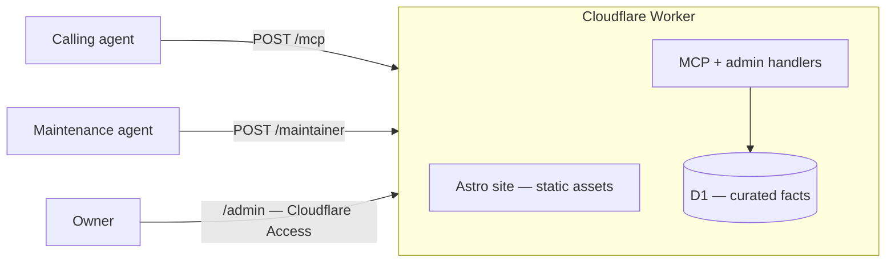

# Cardex

**Know which card to tap.** Ask your AI assistant which Hong Kong credit card to use for dinner, online shopping, or a trip to Japan. With Cardex, it checks the actual rebate rates, caps, and fine print before it answers — and tells you what it couldn't verify.

Under the hood Cardex is a pair: an **Agent Skill** ([`skills/cardex`](skills/cardex/SKILL.md)) that teaches the assistant what to check, and a public **remote MCP** endpoint that returns structured, sourced facts. The assistant does the comparing; Cardex never names a best card and never sees your cards.

> **Status:** pre-alpha, live at [cardex.brandonhk.com](https://cardex.brandonhk.com). Every figure is synthetic and marked illustrative — no real issuer terms yet.

## Review it in 10 minutes

1. **Hit the live endpoint — zero install.** `/mcp` on `cardex.brandonhk.com` is the production Cloudflare Worker — CI `wrangler deploy`s it on every merge — and it speaks stateless streamable HTTP, so plain `curl` works. This is the same `score_candidates` call the landing-page demo renders:

   ```bash
   curl -s https://cardex.brandonhk.com/mcp \
     -H 'content-type: application/json' \
     -H 'accept: application/json, text/event-stream' \
     -d '{"jsonrpc":"2.0","id":1,"method":"tools/call","params":{"name":"score_candidates","arguments":{"amount_hkd":280,"alias":"茶餐廳","merchant":"譚仔","card_ids":["card_hsbc_red","card_aeon"]}}}'
   ```

   Swap the `method`/`params` for `initialize` or `tools/list` to see the handshake and the full tool surface.

2. **See every tool payload locally.** `pnpm install && pnpm demo` migrates and seeds D1, boots `wrangler dev`, and prints eight scripted responses from a real MCP client.

3. **Read the design.** [AGENTS.md](AGENTS.md) for the boundaries and review gates → [docs/adr/](docs/adr/) for why it is shaped this way → [docs/ai-workflow.md](docs/ai-workflow.md) for how agents built the repo.

## Set it up

Paste this into your AI assistant:

```text
Install the Cardex skill so you can look up Hong Kong credit-card facts.

1. Download https://cardex.brandonhk.com/skill.md and save it as cardex/SKILL.md in your skills directory.
2. Add the Cardex MCP server (streamable HTTP, no auth): https://cardex.brandonhk.com/mcp
3. If you can't install skills or MCP servers, read that skill.md now and call the endpoint over plain HTTP as it describes.

Check it works: call list_tags with limit 3 and show me the result.

Cardex returns facts only. You compare the cards, and you tell me which terms you couldn't verify.
```

<details>
<summary>中文版 prompt</summary>

```text
幫我安裝 Cardex skill，等你查到香港信用卡嘅資料。

1. 下載 https://cardex.brandonhk.com/skill.md，存做你 skills 目錄入面嘅 cardex/SKILL.md。
2. 加 Cardex MCP server（streamable HTTP，唔使 auth）：https://cardex.brandonhk.com/mcp
3. 如果你裝唔到 skill 或者 MCP，就即刻讀嗰個 skill.md，照佢講嘅方法用普通 HTTP call 個 endpoint。

試吓得唔得：call list_tags，limit 3，俾我睇結果。

Cardex 只係俾事實。比較邊張卡由你做，邊啲條款你核實唔到，要話俾我知。
```

</details>

Both prompts mirror `prompt.text` in [`packages/site/src/i18n/`](packages/site/src/i18n/) — change them together.

### By hand

The skill is what teaches your assistant to connect, which tool to reach for, and how to settle terms it cannot check.

- **From the site** — [`https://cardex.brandonhk.com/skill.md`](https://cardex.brandonhk.com/skill.md), built from [`skills/cardex/SKILL.md`](skills/cardex/SKILL.md).
- **From this repo** — copy [`skills/cardex/`](skills/cardex/) into your agent's skills directory.
- **From a GitHub Release** — packaged skill: [`v0.3.1`](https://github.com/brandon-wsc/cardex/releases/latest).
- **No skill support?** Connect any MCP client to the endpoint directly — `POST https://cardex.brandonhk.com/mcp`, streamable HTTP, no auth:

```json
{ "mcpServers": { "cardex": { "url": "https://cardex.brandonhk.com/mcp" } } }
```

Two more surfaces share the Worker ([ADR 0002](docs/adr/0002-maintenance-surface.md), [ADR 0007](docs/adr/0007-owner-only-report-triage.md)): `POST /maintainer`, a bearer-token MCP the maintenance agent uses for fact reads and structured proposals (runbook: [`skills/cardex-maintainer`](skills/cardex-maintainer/SKILL.md)); and `/admin`, a Cloudflare Access portal where the owner reviews quarantined reports and approves or rejects proposals. Only approved proposals ever write facts. Everything else on the hostname is the public site.

## What Cardex is

- **Used through your assistant.** People get the benefit; the callers are their AIs (assistants, agents, copilots). The site at `/` talks to people, the tools talk to agents ([ADR 0004](docs/adr/0004-public-site.md)).
- **Facts, not advice.** Cardex returns structured records. It does not choose "the best card" for anyone. Ranking and judgment stay with the calling agent.
- **Small, composable outputs.** Tools return compact results. Callers narrow them with filters, `limit`, and follow-up lookups by `id`. They do not get a whole dataset in one response.

## What Cardex is not

- Not a "which card should I use" app with its own rankings. There is no Cardex app and no Cardex verdict — your assistant does the comparing. It does not compete with SwipeWhich, 小斯, or similar products.
- Not a wallet or card-management product. It stores no user cards, transactions, or personal data.
- Not a live scraper. Data is curated facts in D1 — nothing is scraped at request time.
- Not a RAG system. Lookups are structured queries, not embedding search over documents.

## Tools

| Tool               | Purpose                                                                  |
| ------------------ | ------------------------------------------------------------------------ |
| `lookup_rates`     | Find rebate/earning rates by tag, card, or issuer, with filters and `limit` |
| `get_card`         | Fetch one card's details by `id`                                         |
| `get_term`         | Fetch a specific term/condition (cap, exclusion, validity) by `id`       |
| `list_tags`        | List known spend tags                                                    |
| `resolve_alias`    | Map a free-text name to canonical tag(s) or card(s)                      |
| `score_candidates` | Score cards for a spend under explicit `assumptions`, and report `unknown_exclusions` |
| `report_issue`     | File a wrong-or-stale fact into the quarantine queue for the maintenance loop |

`score_candidates` stays a fact-based calculation. It shows the assumptions it used and lists exclusions it could not check, so the calling agent can decide what to do.

## Architecture (v1)

| Layer    | Choice                                    |
| -------- | ----------------------------------------- |
| Runtime  | Cloudflare Workers                        |
| Language | JavaScript / TypeScript                   |
| Storage  | Cloudflare D1 (SQLite)                    |
| Data     | Curated facts in D1; `seed.sql` is the dev snapshot |
| Protocol | MCP (remote server)                       |
| Site     | Astro static pages (zh-HK at `/`, en at `/en`) + Preact admin island, served as the Worker's static assets ([ADR 0004](docs/adr/0004-public-site.md)) |



### Data model

- **Cards** link to **rates** (earning rules) and **terms** (conditions, caps, exclusions).
- **Tags** classify merchants and spend categories (for example `dining`, `online`, `overseas`). Tags and rates are many-to-many, and tags can overlap. One spend can match several tags.
- **Aliases** map free-text names (merchant names, nicknames, abbreviations) to canonical tags or cards, also many-to-many.

## Run it

Local development:

```bash
pnpm install
pnpm migrate   # apply D1 schema to the local database
pnpm seed      # load seed/seed.sql (synthetic data)
pnpm dev       # build the site, then wrangler dev — site at http://localhost:8787, MCP at /mcp
pnpm dev:site  # Astro dev server for page work only (no /mcp or /admin/api)
```

The site needs Node ≥ 22.23.4 (Astro's floor). `pnpm demo` builds the site, runs the setup steps, boots `wrangler dev`, and prints eight scripted tool payloads (a real MCP client over HTTP). Rates in that output are invented fixtures, not issuer terms. The spec is [`docs/PRD.md`](docs/PRD.md).

## Docs

| Doc | Purpose |
| --- | --- |
| [AGENTS.md](AGENTS.md) | Coding-agent entry: sources of truth, hard boundaries, doc pointers |
| [CONTEXT.md](CONTEXT.md) | Domain language |
| [docs/PRD.md](docs/PRD.md) | Product spec |
| [docs/ROADMAP.md](docs/ROADMAP.md) | Phases after v1 |
| [docs/STATUS.md](docs/STATUS.md) | What exists today |
| [docs/adr/](docs/adr/) | Architecture Decision Records |
| [docs/TESTING.md](docs/TESTING.md) | Test policy |
| [docs/ai-workflow.md](docs/ai-workflow.md) | How agents built this repo — tools, loop, time, gates |

This repo was built by coding agents under the conventions in [AGENTS.md](AGENTS.md). The tools, the review loop, the timing, and an honest account of which human gates were real are in [docs/ai-workflow.md](docs/ai-workflow.md).

## Repository layout

```
.
├── AGENTS.md             # Coding-agent entry
├── CONTEXT.md            # Domain language
├── packages/
│   ├── mcp-worker/       # Cloudflare Worker: remote MCP over D1 (wrangler dev locally)
│   └── site/             # Astro: public pages, /llms.txt, /skill.md, /admin island → Worker static assets
├── skills/
│   ├── cardex/           # Agent Skill: the caller playbook (the product surface)
│   └── cardex-maintainer/# Agent Skill: verify sources + file proposals via /maintainer
├── seed/
│   └── seed.sql          # Synthetic sample data (invented numbers, not issuer terms)
├── docs/
│   ├── ROADMAP.md
│   ├── STATUS.md
│   ├── TESTING.md
│   ├── adr/
│   └── ai-workflow.md    # How agents built this repo
├── LICENSE               # MIT
└── README.md
```

## Data policy

- No card numbers (PANs), personal data, or secrets are stored in this repo.
- No scraped dumps are committed. Seed data is curated; the v1 seed is synthetic (placeholder `source_url`s) until the cited seed lands.
- Card terms change often, so always confirm against the issuer before relying on a value.

## License

[MIT](LICENSE)
