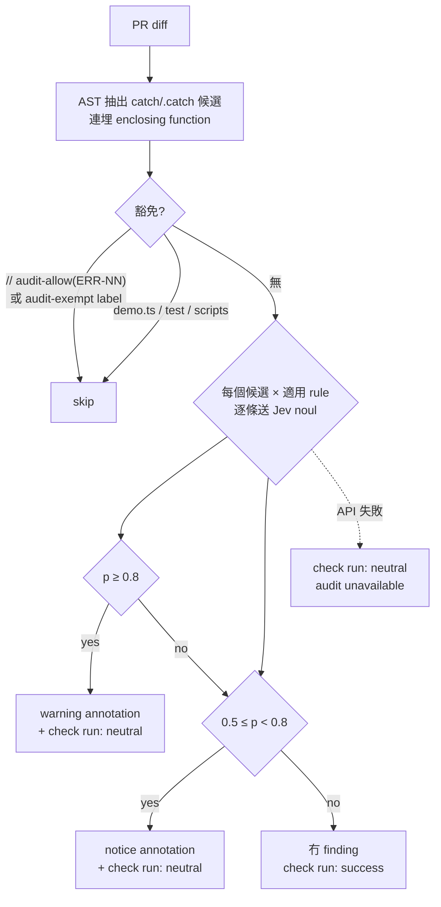
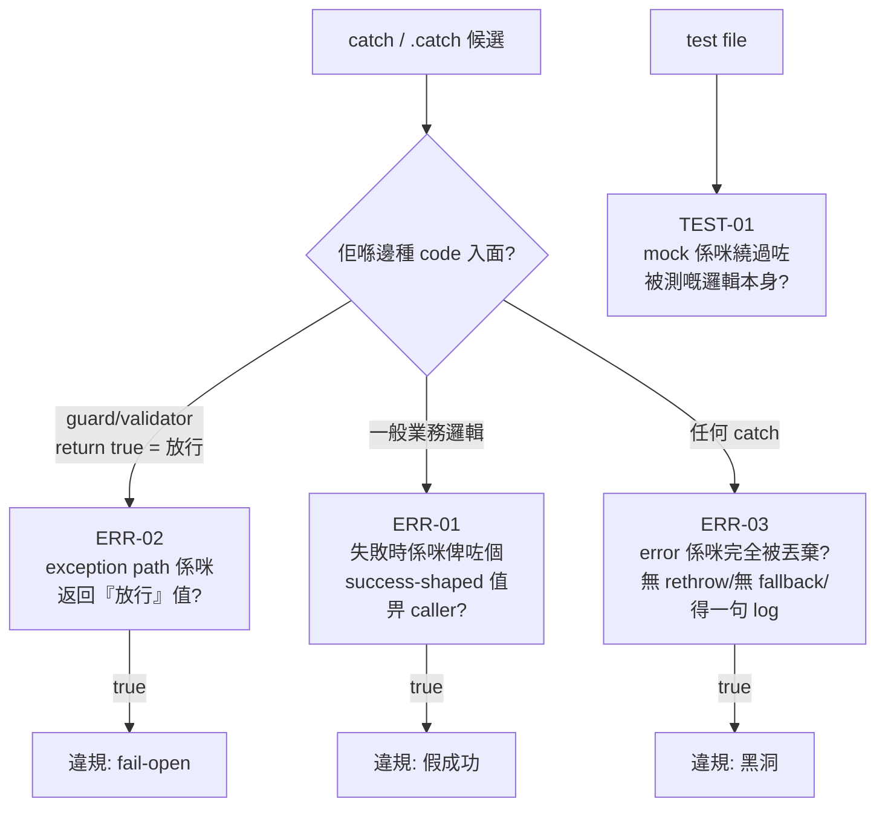

# Audit rules — error handling

Working rules for the Jev-based audit gate (warning-only, not a merge
blocker). Draft status: thresholds and scope are tuned by the backtest in
`scripts/audit-backtest.mjs` before the gate goes live.

## Gate flow

Each catch candidate is classified by the kind of code around it, then
the matching rule's noul question is asked:

## How a rule is shaped

Each rule is a single `noul` question — one yes/no judgment with a short
`instructions` line and true/false `criteria`. The question must be
answerable from one function plus its callers. No prose essays: the
backtest showed long rule text degrades Jev's discrimination, so the
wording below is deliberately terse and is what the gate sends verbatim.

## Scope

- Applies to `packages/*/src/**` production code.
- `demo.ts`, scripts, and test files are out of scope — retry and
  cleanup loops there have different semantics.
- Inline exemption: `// audit-allow(ERR-NN): <reason>` on or above the
  handler. PR-wide opt-out: the `audit-exempt` label.

## Rules

### ERR-01 — fake success on failure

- **applies to**: `catch` blocks and `.catch()` callbacks.
- **instructions**: When the operation in the try block or promise
  fails, does the handler hand the caller a value that lets it continue
  as though the operation succeeded?
- **true**: on failure the caller receives a success-shaped result —
  `ok: true`, an applied/created status, a populated object fabricated
  after the failure — and cannot tell the operation failed.
- **false**: the error propagates (rethrow), becomes an explicit error
  result the caller must handle (`fail(...)`, error enum, thrown
  Response), or the fallback is a conservative rejection.

### ERR-02 — permissive default in a guard

- **applies to**: handlers inside validators, auth checks, URL/protocol
  filters, signature or claim verification — any predicate where `true`
  means "allow" / "trust this".
- **instructions**: In a guard that decides whether input is allowed or
  trusted, does the exception path return a permissive verdict?
- **true**: a parse, fetch, or verification failure returns the value
  that treats the input as valid or trusted (`true`, the principal, an
  open decision).
- **false**: the failure returns the denying verdict (`false`, `null`
  the caller turns into a rejection) or propagates as an error. A
  `catch → false/null` in a guard is compliant — that is fail-closed,
  not a swallowed error.

### ERR-03 — error dropped with no substitute

- **applies to**: `catch` blocks whose body has no return, no rethrow,
  no error result, and at most a log line.
- **instructions**: Is the caught error discarded entirely — no rethrow,
  no failure result, no fallback value — so execution continues as if
  the operation never failed?
- **true**: the handler only logs or is empty, and the function goes on
  to return a normal result or nothing, hiding that work did not happen.
- **false**: the handler rethrows, returns an error result, supplies a
  fallback value, or the catch exists to tolerate an already-expected
  failure (best-effort cleanup, a process that may already be dead).

### TEST-01 — mock bypasses the unit under test

- **applies to**: `*.test.ts` / spec files.
- **instructions**: Does the test mock away the very code path it claims
  to verify, so the assertion can pass without the real logic running?
- **true**: the mock replaces or short-circuits the function/module under
  test, or the test asserts only on the mock's own behavior.
- **false**: mocks stand in for external boundaries (network, database,
  clock) while the real unit under test still executes and is what the
  assertion measures.

## Known boundary cases (from the backtest)

These shapes score borderline and guide threshold choice:

- `catch → return false` inside a validator — compliant (ERR-02 false).
- `catch → return null` where every caller maps null to rejection —
  compliant on this codebase; flag when a caller uses the value without
  a null check.
- `.json().catch(() => ({}))` on a request body — borderline: compliant
  only if a later check rejects the missing fields (see
  `handleProposalDecide`, which re-validates `decision`).
- Retry loops and process cleanup that swallow by design — out of
  scope, or exempt inline.
