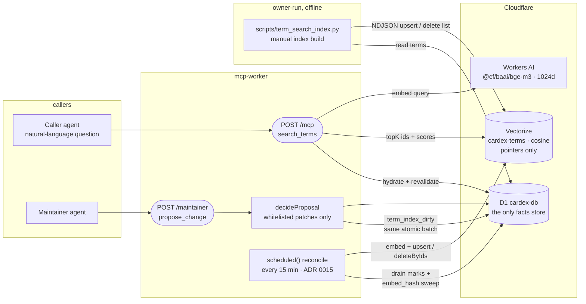
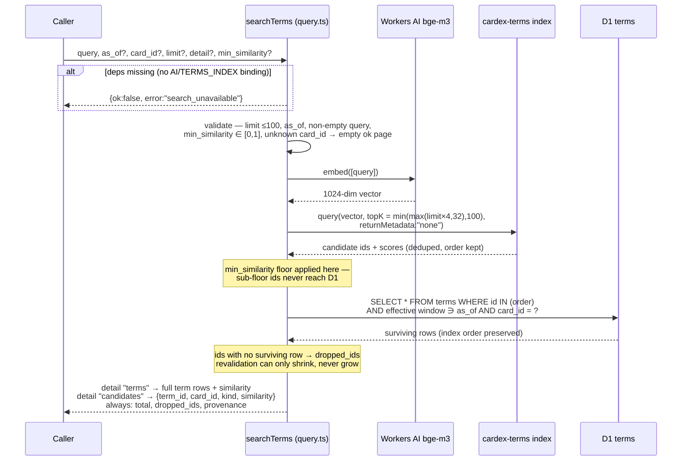
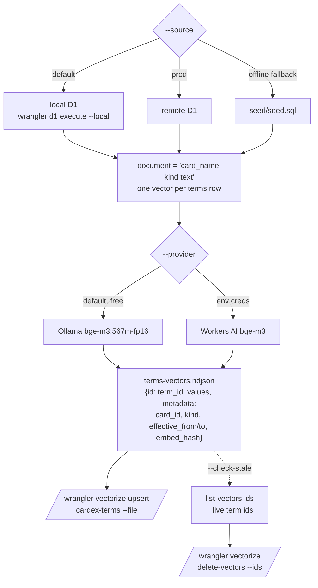
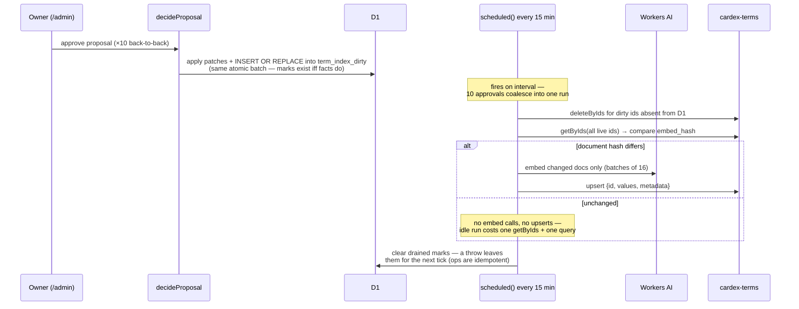

# Term search — current design (visual companion)

> **Status:** Experimental, live in prod. This file only *draws* [ADR 0014](adr/0014-semantic-term-search.md) — the ADR and [PRD](PRD.md) are the contract; if anything here disagrees, they win.
> Verified against `cardex.brandonhk.com/mcp` on 2026-11-16.

## 1. Big picture

Two write paths exist; they never meet in a request:

- **Facts** — maintainer proposes → owner approves in `/admin` → `decideProposal` applies patches to D1 (and marks `term_index_dirty` in the same batch). The only path that changes truth.
- **Index** — `scheduled()` reconciles every 15 min from D1; owner can also run `term_search_index.py` → `wrangler vectorize upsert` / `delete-vectors`. Derived, rebuildable, pointers only.

## 2. Read path — `search_terms` request

## 3. Index build — offline script

Metadata is for diffing and debugging — `returnMetadata:"none"` at query time means the request path never even reads it. `embed_hash` (sha256 of the document) is what lets a reconcile skip unchanged rows.

## 4. Invariants

| Invariant | Enforced by |
|-----------|-------------|
| Index stores **pointers, never facts** — no term `text` in Vectorize | index builder writes id + metadata only |
| Revalidation **shrinks, never grows** — index cannot add a fact D1 wouldn't return | hydration `WHERE id IN … AND window AND card_id` |
| `similarity` is a **retrieval signal, not a fact** — no calibrated cutoff exists (wrong hits ~0.64 vs correct ~0.51 on the stress set) | raw score echoed; `min_similarity` is a caller knob, not Cardex policy |
| **Fail closed** — no silent lexical fallback | missing bindings or embed/index error → `search_unavailable` |
| Fact writes go **only** through propose→approve→apply | `decideProposal` whitelisted patches; nothing on the read path writes the index |

## 5. Degradation modes (all safe by construction)

| Situation | Caller sees |
|-----------|-------------|
| Bindings missing / embed or index error | `{ok:false, "search_unavailable"}` + `isError` |
| Stale pointer (term deleted, expired, another card's) | id lands in `dropped_ids` |
| New term approved but not yet indexed | absent — the index cannot invent it |
| Empty index | `ok` page, `total: 0` |
| Unknown `card_id` | `ok` page + `unknown_card_id` |
| No relevant term exists | low-scored candidates may still return — discovery, not proof |

## 6. Index sync — dirty marks + scheduled reconcile (ADR 0015)

N proposal approvals do not mean N index runs: marks coalesce in a set, and the cron interval is the debounce window.

- **Dirty marks are the delete record** — the binding has no `listVectors`, so a deleted term is only known via the apply-time mark.
- **The `embed_hash` sweep is the insert/update reconciler** — self-heals a missed mark or an owner console edit; deletes stay mark-dependent by construction (`scripts/term_search_index.py --check-stale` remains the orphan sweeper).
- **The hook only marks, never embeds** — index failure can never roll back an approval.
- **Doc + hash byte-identical with the python builder** — `"{card_name} {kind} {text}"`, sha256 utf-8; pinned by a cross-impl spec.
